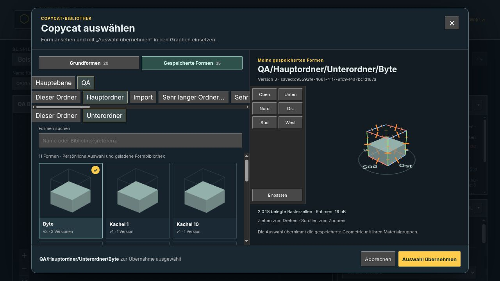
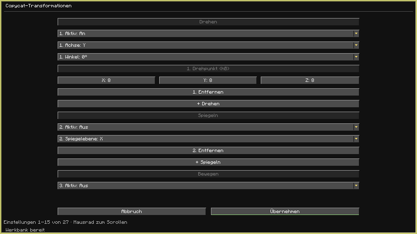
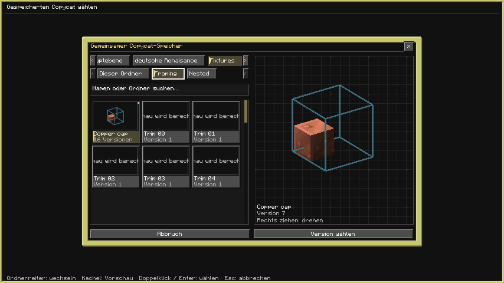

# Graphstudio: Entwicklungsstand und Prüfbericht · 15.11.2026

> Dieser Bericht dokumentiert die lokale Abnahme vor der Veröffentlichungsfreigabe. Der anschließend veröffentlichte Quellen-Pin und die öffentliche Adresse stehen in der [Graphstudio-README](../README.md).

Die neue Copycat-Auswahl und die Funktionen aus Issues 29–36 sind im Organisationseditor implementiert. Fachkern und native Ergänzungen liegen sowohl in der lokalen Mod als auch in einem isolierten Entwicklungsstand auf öffentlicher Basis 0.6.4 vor. Die automatisierten Prüfungen und beide nativen UI-Smokes bestehen. **Die vollständige Abnahme bleibt wegen der noch offenen Prüfung mit echtem Browserzoom auf 200 % ausstehend.**

## Quellen und Auslieferung

- Organisationseditor: `graphstudio/adapters/copycat/web`; der lokale Browser-Prototyp ist nicht Haupteditor und wurde nicht eingebaut.
- Öffentliche Basis: `726214ce74a9ad7dc6e7ad251aee9d2bbb68ebb1` (0.6.4), Entwicklungsworktree `/home/alex/.codex/worktrees/graphstudio-contract/Copycat Architect`.
- Lokale Mod: `/home/alex/VoxelTeutonModding/Copycat Architect`; vorhandene lokale Funktionen und Änderungen bleiben erhalten.
- Interner Build: `.internal-dist`; Lieferpaket: `.cache/delivery-2026-11-15`. `manifest.json` enthält SHA-256, Dateigrößen und Quellenfingerprints; `SHA256SUMS` prüft die Lieferdateien.
- Zwei getrennte Entwicklungs-JARs: lokale Version 0.5.1 und öffentliche Basis 0.6.4. Der öffentliche Entwicklungs-Patch enthält auch neue Dateien. Nicht beide JARs gleichzeitig installieren.
- Keine Veröffentlichung, kein Push, keine Issue-Schließung, kein Deploymentwechsel. `sources.lock.json` bleibt auf dem veröffentlichten Pin. Der öffentliche Build prüft weiterhin saubere öffentliche Quellen und lehnt den alten Kern für den neuen Adapter verständlich ab. Der Entwicklungsbuild ist als interner Kanal gekennzeichnet.

## Funktionen

| Bereich | Umsetzung und wesentliche Absicherung |
| --- | --- |
| Copycat-Auswahl | Grundformen/Gespeichert, Ordnerreiter je Ebene, direkte Inhalte, globale Namensgruppen-Suche, interne Navigation und Raster mit 1–3 Spalten, große Vorschau, genaue separate Versionswahl, vollständige Schlüssel/Tooltip, sichtbare zwischengespeicherte Materialvorschauen und Fehlerersatz. Desktop nebeneinander, schmal untereinander. Ordnerwechsel übernimmt keine Quelle. |
| #29 | Typisierte Rotation, Spiegelung und Positionierung in beiden Graphen; unverbundene Parameter nutzen Inspektorwerte. 90° um X/Y/Z mit hB-Drehpunkt, relative ganzzahlige Bewegung, bestehende 13 Spiegelregeln. Grenzen werden nach jedem aktiven Schritt geprüft; Diagnose statt Clipping. |
| #35 | Instanzbezogene `copycatTransforms` nach jeder Copycat-Auswertung. Drei Inspektorabschnitte und gemeinsame globale Reihenfolge, Aktivierung und atomare Übernahme. Gemeinsamer exakter Auswerter erhält Materialgruppen und Herkunft. Auch gemeinsame Gruppendefinitionen überschreiben keine Listen anderer Instanzen. |
| #30 | Gemeinsamer nativer Duplizierbefehl, Kontextmenü und Strg+D außerhalb von Texteingaben. Neue IDs, Versatz 32, nur interne Kanten und Gruppenbindungen remappt, Pflicht-/Ergebnisknoten ausgeschlossen, ein Undo/Redo-Schritt. Browser-Erweiterungsmetadaten bleiben erhalten. |
| #31 | Neu/Öffnen/Speichern/Speichern unter/Import/Export/Löschen; gemeinsamer Dateidialog für Graphen, Formen und Gruppen. Migration alter IDs auf Version 1, unveränderliche Versionen, neue Identität bei Speichern unter. Löschbestätigung mit Abhängigkeiten und Sperre tatsächlich referenzierter Versionen. Separate geprüfte JSON-Arbeitskopien, Abbruch ohne Änderung, atomare Übernahme/neue Version. CAS schützt konkurrierende Tabs; Backups überschreiben keine unveränderliche Version. |
| #32 | Koordinaten gleich breit horizontal (XYZ Drittel, XZ Hälften) mit festen Abständen; beschriftete vertikale Felder bei geringer Breite, auch im nativen Eigenschaftendialog. |
| #33 | Zentrale semantische Portangaben mit Farbe, Name und Symbol im gemeinsamen Katalog, Browserkanten und native Anschlüsse, aufklappbare Legende. Achsenmarkierungen ergänzen die Typen; Fachregeln bestimmen Kompatibilität. |
| #34 | Materialdialog im Vorschau-HUD mit explizitem Ziel Graph/Selektiert; Mengen aus nativem Plan-/Materialauswerter, nach Registry-ID einschließlich Blockzustandsvarianten aggregiert, Zink separat. Icons und lesbare Ersatzangaben für unbekannte Assets. |
| #36 | Alle sechs Seitenansichten und Einpassen in einer Fläche, bei geringer Höhe kompaktes mehrspaltiges Raster, mindestens 32 CSS-Pixel. Ein intern scrollendes Informations-HUD; Kameraklicks ändern den Website-Scrollstand nicht. |

Neue Funktionen benötigen Formgraphschema 4 bzw. Gebäudegraphschema 5. Alte Dokumente ohne diese Funktionen behalten Schema und Ergebnis. DTO-Generator, Katalog, Validatoren und Kotlin/JS-Codec verwenden denselben Vertrag. Details: [TRANSFORM-CONTRACT.md](TRANSFORM-CONTRACT.md).

## Automatisierte Ergebnisse

| Prüfung | Ergebnis |
| --- | --- |
| Lokale vollständige JVM-Suite + Build | 2.974 Fälle, 2.972 bestanden, 0 Fehler, 2 vorhandene optionale Welt-Snapshots übersprungen |
| Öffentliche Basis: vollständige JVM-Suite + Build | 591 Fälle, 589 bestanden, 0 Fehler, dieselben 2 optionalen Welt-Snapshots übersprungen |
| Organisationsadapter Browser | 159 bestanden, 0 Fehler, 0 übersprungen |
| Öffentlicher Kern: gezielte Pflichtfälle | 12 bestanden, 0 übersprungen; zusätzlich Browser-Export- und Rückimportprüfungen |
| Lokaler Kern: gezielte Pflichtfälle | Transformationsvertrag, Parametervorschauen und Austauschbrücke ohne übersprungene Fälle bestanden |
| Quellen-/Veröffentlichungsschranken | 3 bestanden, 0 übersprungen |
| Nativer Graph-UI-Smoke | Form, Gebäude und Drucker jeweils normal/kompakt: Duplizieren, +32, Undo/Redo, Transformationseditor, Portdarstellung bestanden |
| Nativer `savedCopycatSmoke` | Ordner, Scrollgrenzen, Raster/Tastatur, Materialien, ältere genaue Version, Größenwechsel, Tisch/Drucker und atomare Übernahme/Undo/Redo bestanden |

Die zwei optionalen Überspringungen betreffen `SemanticVorlagenSnapshotTest.saved depot...` und `VorlagenRoomSnapshotTest.saved Lagerhalle...`, deren externe gespeicherte Welten nicht vorhanden sind. Sie sind keine Fälle des neuen Pflichtkorpus. Kein neuer automatisierter Pflichtfall wurde übersprungen. Die vollständigen XML-/HTML-Berichte und Logs liegen im Lieferpaket. Nach der vollständigen Suite wurde ausschließlich eine Leerzeichenzeile in `BuildingGraph.kt` bereinigt; der interne Pflichtlauf und der vollständige öffentliche Build mit allen 591 Fällen wurden danach erneut erfolgreich ausgeführt.

Der gemeinsame Korpus enthält **9 Fälle**: exakte Diagonale, geordnete Transformationen, duplizierte Transformationen, typisierter Positionsparameter, rationale Dachgeometrie, benannte Gruppeneingänge, duplizierte gebundene Gruppe mit eigener Transformationsliste, transformierter Gebäudegraph und ältere explizite Projektion. Er durchläuft lokale JVM → Browser → öffentliche JVM; zusätzlich öffentliche JVM → Browser → öffentliche JVM. Der Gebäudegraph referenziert ausdrücklich Version 3, obwohl Version 4 mit anderer Geometrie existiert. `exchange/*.json` enthält Originale und Browser-Rückexporte.

Die Tests prüfen unter anderem Operationsreihenfolge, Drehpunkte, deaktivierte Schritte, Grenzdiagnosen, Knotenketten/Listen-Gleichheit, Materialien/Herkunft, unabhängige Referenzinstanzen, Migration, unveränderliche Speicherstände, Löschsperren, JSON-Fehler/Abbruch, Wiederöffnung, Sicherungsimport und konkurrierende Revisionen.

## Sicht- und Bedienprüfung im echten Client

Im In-app-Browser geprüft: Desktop 1280×720, Tablet 768×1024, Mobil 390×844, schmale Vorschau und kurze Ansicht 640×360. Ordnerpfade mit drei Ebenen, lange überlaufende Reiter, direkte Ordnerinhalte, globale Suche/keine Treffer/Rückkehr, zeilenweise Pfeilnavigation, genaue alte Version (512 statt 2.048 Rasterzellen), Fokus/Abbruch, Strg+D/Undo/Redo, reparierbarer Grenzfehler, Materialziel, gleiche Koordinatenbreiten und alle sieben Kameraaktionen wurden bedient.

Dateidialog im echten Browser: alte Version wieder geöffnet, Löschbestätigung abgebrochen, tatsächlich referenzierte Version gesperrt (Abhängigkeit `QA/Referenz` sichtbar), fehlerhaftes JSON gesperrt und abgebrochen, gültige Bearbeitung als neue Version bei unverändertem Ordner gespeichert, Knotengruppe im gemeinsamen Dialog geprüft. Ein Bibliotheksbackup mit altem Version-1-Eintrag wurde über die echte Dateiauswahl importiert. Zwei Tabs erzeugten nach konkurrierender Änderung den erwarteten Konflikt; Wiederladen erhielt die erfolgreiche Änderung.

Der zusätzliche native Auswahl-Smoke scheiterte beim ersten Versuch während der NeoForge-Fensterübergabe, bevor die Anwendung geladen war. Nach Neustart bestand der vollständige Lauf; der abschließende Erfolgslog ist beigefügt.

### Offene Abnahmegrenze

**Echter Browserzoom auf 200 % wurde nicht erfolgreich eingestellt.** Die Tastenkombination hatte im verfügbaren In-app-Browser keine Zoomwirkung. Der entsprechende Reflow wurde bei halbiertem CSS-Viewport (640×360 gegenüber 1280×720) geprüft und verbessert. Diese Prüfung ersetzt keinen tatsächlichen 200-%-Zoomlauf. Beim abschließenden erneuten Screenshotlauf reagierte zudem die Viewport-Steuerung nicht mehr; die Desktop-Abschlussaufnahme gelang, die mobilen Zwischenaufnahmen werden deshalb nicht als Abschlussbeleg ausgeliefert. Vor vollständiger Abnahme muss der reale 200-%-Zoomlauf in einem Browser mit funktionierender Zoomsteuerung nachgeholt werden; mobile/kurze Ansichten sollten dabei erneut als Abschlussbilder festgehalten werden.

## Reproduzieren

Im Organisationsverzeichnis, Java 21 und vorhandene Offline-Abhängigkeiten verwenden:

```sh
npm test
JAVA_HOME=/home/alex/.gradle/jdks/eclipse_adoptium-21-amd64-linux.2 npm run internal -- --copycat '/home/alex/.codex/worktrees/graphstudio-contract/Copycat Architect' --local '/home/alex/VoxelTeutonModding/Copycat Architect'
npm run preview -- --internal
```

In jedem Modstand: `./gradlew test build --offline --console=plain`. Lokal zusätzlich `./gradlew runClient -PgraphSelectionSmoke --offline` und `./gradlew runClient -PsavedCopycatSmoke --offline` bei verfügbarem Grafikserver. Der interne Preview läuft auf [127.0.0.1:4318](http://127.0.0.1:4318/copycat/?editor=form).

## Abschlussbilder






