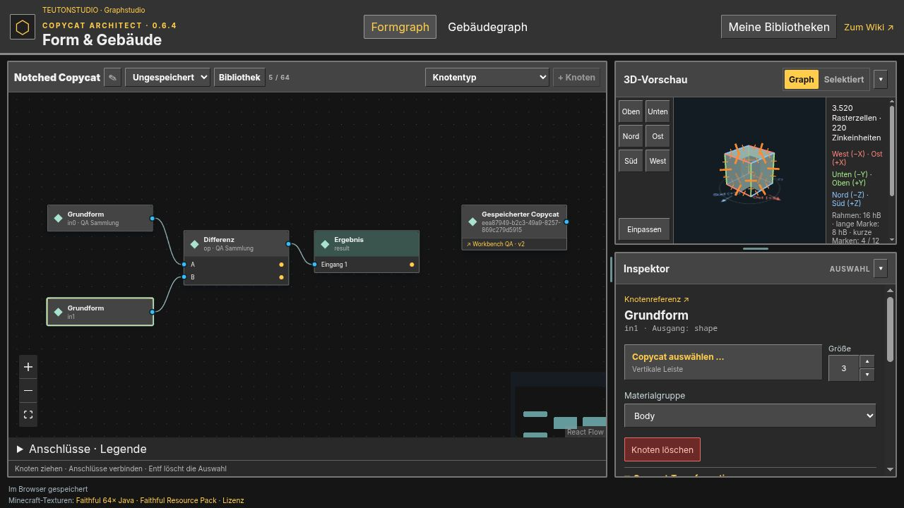
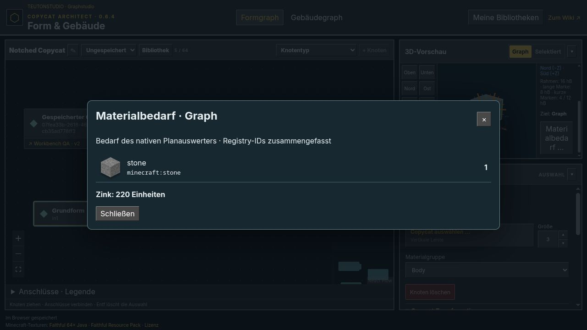
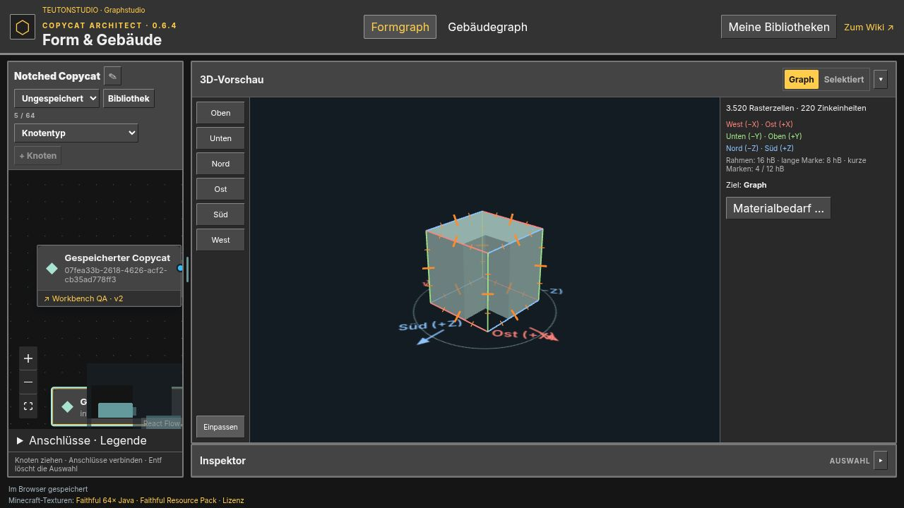
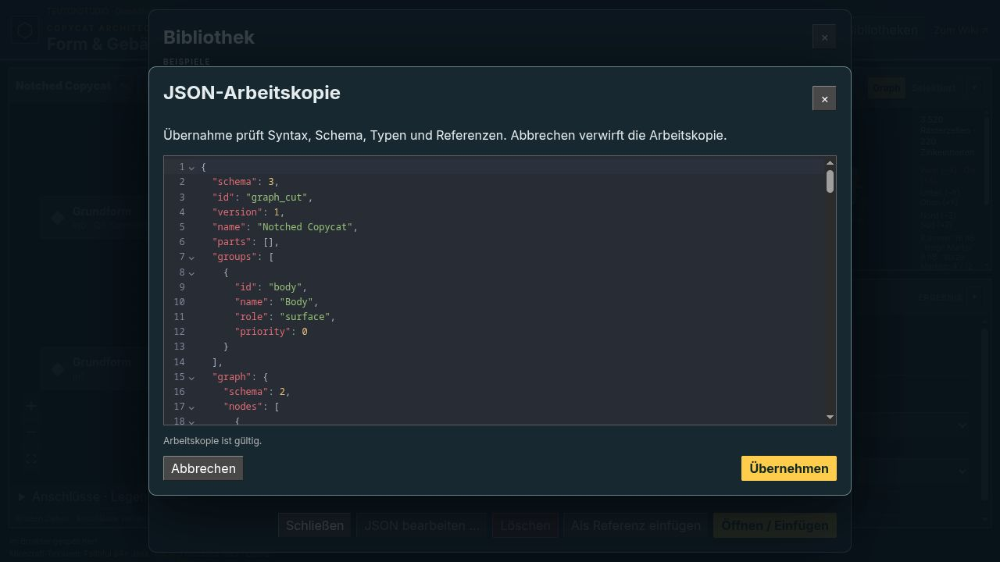

# Graphstudio: Arbeitsfläche und Bibliothek · 15.11.2026

> Dieser Bericht dokumentiert die lokale Abnahme vor der Veröffentlichungsfreigabe. Der anschließend veröffentlichte Quellen-Pin und die öffentliche Adresse stehen in der [Graphstudio-README](../README.md).

Der Umbau betrifft ausschließlich die Reactflow-App im Organisationsrepository und ihren Browser-Build. Die Modquellen und der öffentliche Quellen-Pin bleiben unverändert. Keine Veröffentlichung oder Deployment-Ablösung.

## Umsetzung

- **Fensterfüllende Arbeitsfläche:** Die Seite besitzt keine vertikale oder horizontale Scrollstrecke. Graph, Inspektor, Vorschau-HUD und Dialogbereiche bleiben begrenzt; lange Inhalte scrollen intern. Mobil liegen Graph und Seitenbereich untereinander.
- **Graph-Kopfzeile:** Name, Stift zum Umbenennen, Versionsauswahl und Bibliotheksbutton. Die bisherigen beiden Aktionsleisten sind im Bibliotheksdialog untergebracht. Knotentyp und Hinzufügen bleiben an der Arbeitsfläche erreichbar.
- **Versionen:** `Ungespeichert` ist bearbeitbar; gespeicherte Versionen sind Betrachtungsansichten. Knotenpositionen dürfen in der Ansicht verschoben werden, ohne den Speicherstand oder Entwurf zu ändern. Knoten, Verbindungen und Eigenschaften sind dort gesperrt. Auch das Betrachten eines anderen Graphen ersetzt den aktiven Entwurf nicht. Eigene Entwürfe werden pro Dokumentidentität aufbewahrt; Bibliothek und Materialien einer Version werden getrennt vom Entwurf aufgelöst.
- **Kompass:** Vier radial nach außen gerichtete Pfeile auf dem Boden, senkrecht zum Kreis am jeweiligen Kreispunkt. Die Schäfte beginnen innen; die kompletten Pfeilköpfe liegen außerhalb des Kreises. Nord/Süd tragen −Z/+Z in Blau, West/Ost −X/+X in Rot. Pfeile und Anker bleiben in Weltkoordinaten; nur die Beschriftung dreht sich um die vertikale Achse zur Leseposition der Kamera.
- **Materialbedarf:** Isometrische Inventaransicht mit eigenen Texturen für Oberseite und zwei Seiten des Materialblocks; Schatten unterscheiden die Seiten. Fehlende Assets erhalten eine beschriftete Ersatzvorschau.
- **Löschen:** Erster Klick färbt Eintrag und Knopf rot; der zweite Klick auf „Jetzt löschen“ entfernt den Eintrag. Die Dialoghöhe ändert sich dabei nicht. Wechsel der Auswahl oder des Filters hebt das Ziel auf. Referenzierte Versionen bleiben gesperrt und zeigen ihre Abhängigkeiten.
- **Referenzknoten:** Gespeicherte Formen können in Form- und Gebäudegraphen als einzelne Copycat-Knoten eingefügt werden. Die genaue Version und Materialien werden übernommen und am Knoten sowie im Inspektor angezeigt. Explizite Bibliotheksreferenzen sperren das Löschen ihrer Version. Alle Versionen der eigenen Identität sind als Quelle deaktiviert. Neue Referenzknoten erhalten einen freien Platz neben dem Graphen und werden durch Einpassen sichtbar. Knotengruppen nutzen weiterhin die vorhandene Einfügeaktion.
- **JSON:** CodeMirror mit Zeilennummern, Syntaxfarben, Klammerfaltung und eigenem Bearbeitungsverlauf. Syntax-, Schema-, Typ- und Referenzprüfung bleiben erhalten. Abbrechen verändert nichts; gültige Übernahme ist ein Änderungsschritt. Der Texteditor bekommt den Eingabefokus.
- **Sammlungsdaten:** Mehrfachselektion zeigt eine gemeinsame Inspektorsektion für Löschen, Duplizieren ohne Verbindungen, Duplizieren mit Verbindungen und Gruppenbildung. Mit Verbindungen bleiben externe Eingangsquellen erhalten; interne Eingänge werden auf die Kopien gelegt. Bestehende Verbraucher bleiben unverändert. Ohne Verbindungen werden alle Eingänge der Kopie getrennt; kopierte Gruppen bekommen eine eigene Definition. Pflichtknoten sind geschützt. Undo/Redo umfasst die Aktion.
- **Copycat-Inspektor:** Die alten Dreh-, Neigungs-, Oben/Unten- und Versatzfelder sind ausgeblendet; vorhandene Werte bleiben im Dokument erhalten. Veränderliche Größe erscheint nur bei dafür geeigneten Grundformen, direkt neben der Copycat-Auswahl mit kompaktem Zahlenfeld und zwei gestapelten Schaltern.

## Prüfung

**169 Browsertests bestanden, 0 Fehler, 0 übersprungen.** Dazu 3 bestandene Prüfungen der öffentlichen Build-Schranken. Der interne Vite-Produktionsbuild ist erfolgreich. Der vorhandene Kotlin/JS-Kern wurde verwendet; der Quellenfingerprint des nativen Fachkerns stimmt weiterhin mit dem zuvor geprüften internen Stand überein. In diesem Durchlauf wurden keine Mod-JARs oder JVM-Builds erzeugt.

Im echten Browser geprüft:

| Ansicht | Seitengröße / Fenstergröße | Ergebnis |
| --- | --- | --- |
| Desktop | 1280×720 / 1280×720 | Keine Seitenscrollstrecke |
| Tablet | 768×1024 / 768×1024 | Keine Seitenscrollstrecke |
| Kurze Ansicht | 640×360 / 640×360 | Keine Seitenscrollstrecke, interne Panels |
| Handy | 390×844 / 390×844 | Keine Seitenscrollstrecke; Bibliothek innerhalb 32–812 px |
| Interner Produktionsbuild | 1544×725 / 1544×725 | Keine Seitenscrollstrecke, keine Browserfehler |

Weitere Bediennachweise: Stift/Umbenennen, Speichern von v1/v2, Selbstreferenzsperre, schreibgeschütztes Öffnen, erlaubtes Verschieben einer Ansicht und unveränderte Positionen im Entwurf; fremden Graphen betrachten und nach Neuladen den ursprünglichen Entwurf mit fünf Knoten wiederfinden; beide Duplizierarten einschließlich externer Eingänge, Gruppenbildung, Auswahl löschen und atomisches Undo/Redo; JSON-Faltung auf einen Bereich und zurück, farbige Schlüssel/Zahlen/Zeichenketten, ungültige Übernahme gesperrt und abgebrochen, gültiges JSON übernommen und vollständig mit einem Undo zurückgesetzt; Formreferenzen in beiden Graphtypen, genaue Version und Löschsperre; konstante Höhe von 696 px vor/nach Löschmarkierung; alle sieben Kameraaktionen mit anschließendem `scrollY = 0`; feste und veränderliche Copycat-Größe.

Die tatsächliche Bibliotheksentfernung wird durch die automatisierten Speicherprüfungen abgesichert. Im Browser wurden Markierung, Abbruch und Sperre geprüft; es wurde dort kein Bibliothekseintrag dauerhaft gelöscht.

## Lokaler Build und Belege

- Laufende [interne Vorschau](http://127.0.0.1:4318/copycat/?editor=form).
- Browser-Lieferpaket: `.cache/graphstudio-workbench-2026-11-15.zip` mit statischem Build, Adapterquellen, Logs, Prüfsummen und Bildern. Keine Mod-JARs.
- Reproduzierbarer vollständiger interner Organisationsbuild wie bisher über `npm run internal -- --copycat /Pfad/zum/Entwicklungskern`. Die Installation berücksichtigt jetzt die aktuelle Lockdatei auch bei vorhandenem Build-Cache.
- Browserprüfung mit dem eingerichteten Overlay: `npm test`, danach `VITE_STUDIO_CHANNEL=internal npm run build` in `.cache/copycat-development/web`.

