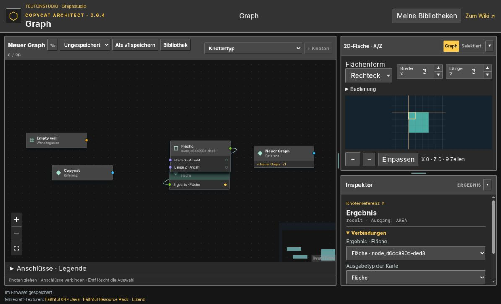
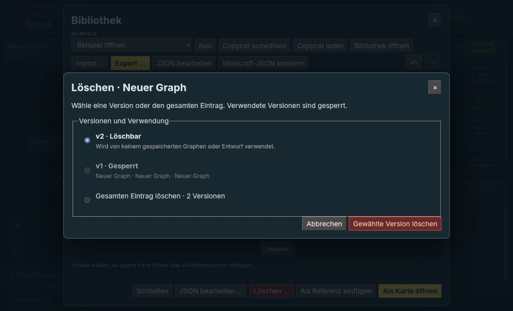

# Graphkarten, Rasterflächen und dynamische Segmente · 15.11.2026

Der Organisationseditor verwendet einen Graphen für alle nativen Knotenfamilien.
Der Ergebnisknoten legt den Kartentyp fest. Alte gespeicherte Form-/Gebäudeversionen
bleiben unverändert; ihre Arbeitsansicht wird beim Öffnen in eine Graphkarte
überführt. Knotengruppen öffnen als eigene Karten; Referenzeinfügen bleibt eine
separate, versionengenaue Aktion. Gruppen lassen sich in derselben Identität als
neue unveränderliche Version speichern.

Flächen unterstützen Quadrat (ein Anzahlanschluss), Rechteck (zwei) und Anklicken
(keine Eingänge). Das X/Z-Raster ersetzt die 3D-Vorschau für die Fläche, auch bei
einer Flächenkarte als Graph-Ergebnis. Klick, Ziehen und Tastatur schalten Zellen;
eine Zeichenbewegung ist ein Undo-Schritt. Leere Masken bleiben reparierbare
Entwürfe. Dynamische Segmentachsen werden vor der Geometrieauswertung an den
Verbrauchern aufgelöst; Operatoren reichen sie einschließlich Achsendrehung
weiter. Der neue Dachknoten ordnet Fläche, First, innere/äußere Ecke und
Wandsegment automatisch zu. Alte Dachvarianten bleiben lesbar.

Versionslisten sind nach Sammlung und Identität gruppiert. Der Löschdialog zeigt
jede Version mit ihrer Verwendung und sperrt referenzierte Versionen sowie die
Gesamtlöschung bei bestehenden Referenzen. Änderungen prüfen den aktuellen
Workspace synchron; die bestehende IndexedDB-Revisionsprüfung bleibt erhalten.
Reine Anzahl-/Positionsreferenzen belegen keine unbenutzten Materialrollen;
mehrere solcher Referenzen bleiben unabhängig auswertbar.
Positionseingänge der Vektoroperationen heißen Position statt Copycat. Die im
Client reproduzierte Rücksetzung der Mehrfachauswahl wurde behoben.

## Nachweise

- Fachkern: `629531f65a272476c42ad696405f75ebf06e1e84` auf dem öffentlichen Branch
  `codex/area-grid-dynamic-segments`, Basis 0.6.4; sauberer Quellen-Pin.
- Vollständiger lokaler JVM-Lauf: 608 Tests, 606 bestanden, 0 Fehler. Zwei
  unveränderte optionale externe Vorlagensnapshot-Tests sind ohne ihre
  Umgebungsdateien nicht aktiviert. Keine Minecraft-Clientabnahme behauptet.
- Öffentlicher Build aus veröffentlichten Quellen erfolgreich. 203 Browsertests,
  alle bestanden, keine übersprungen. 23 Fälle JVM → Browser → JVM. Der
  verpflichtende JVM-Browser-Rücklauf wurde separat ohne Überspringen ausgeführt.
  Beim ersten JVM-Durchgang eines frischen Builds fehlen erwartungsgemäß noch
  Browserexporte; der zweite Durchgang prüft die erzeugten Exporte vollständig.
- Root-Prüfungen für Quellen-Pin und Trennung interner/öffentlicher Ausgaben: 3/3.
- Adapterfingerabdruck: `81601643d4015d3fe7dc6b122cbbd730ff810a9208f15b570a28c5d106a6e319`.
- Im echten Browser geprüft: Quadrat/Rechteck/Zeichnen, Maus- und Tastaturwahl,
  dynamischer Innenanschluss, Positionsbeschriftungen, Mehrfachauswahl,
  Gruppenspeicherung und Öffnung als eigene Karte (4 statt zuvor 8 Knoten),
  Versionen v1/v2 zusammengefasst, genaue Referenz auf v1 und sichtbare Löschsperre.
- CSS-Viewport 1195×725, 768×1024 und 390×844: Dokumentmaße entsprechen dem
  Viewport; kein vertikaler Seiten-Scroll. Raster- und Inspektorbereiche scrollen
  intern. Physischer Browserzoom 200 % wurde in diesem Lauf nicht verifiziert.

Ältere lokale `NORMAL`-Rotationen mit einem Winkel ungleich null lassen sich
noch nicht in eine gemeinsame Karte übernehmen. Der Editor weist dies ausdrücklich
ab; die gespeicherte Originalversion bleibt unverändert und in der Vorschau lesbar.
Solche Operationen müssen vor der Übernahme auf X/Y/Z umgestellt werden.

Schema 7 kennzeichnet neue Flächen/Dynamik/Dachanschlüsse; Schema 8 typisierte
Karten und Inline-Copycats. Bestehende Release-JARs und der lokale Modstand wurden
nicht ersetzt. Der Bericht weist Quellkompatibilität aus, keine Binärfreigabe.

