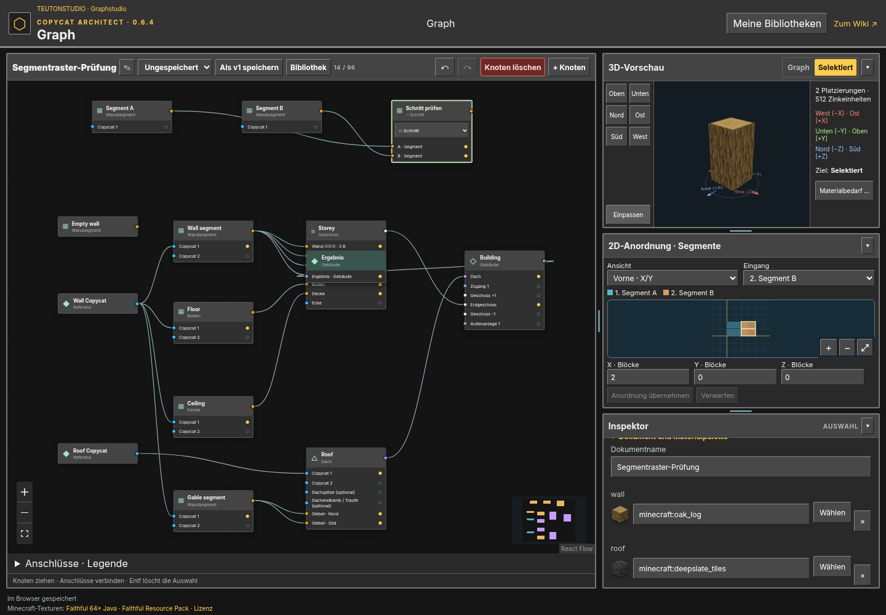

# Graphstudio: direkte Flächen und relative Segmentpositionen

Abnahme: 20. November 2026. Der öffentliche Build verwendet den gepinnten
[Kotlin-Fachkern e583178](https://github.com/TeutonStudio/Copycat-Architecture/commit/e5831781f92985e65557f91be63c651d6955ce6c).
Er enthält auch die bereits veröffentlichten Operatorfamilien und Spiegelwerte.

## Bedienung

- Rückgängig, Wiederholen und Löschen stehen im Graphkopf. Löschen berücksichtigt Mehrfachauswahl und gewählte Verbindungen.
- Materialgruppen und Gebäudepalette verwenden einen Dialog mit Blockitem-Miniaturen, Suche, Zuständen und Übernehmen/Abbrechen. Die direkte Material-ID-Eingabe bleibt erhalten. Paletten speichern weiterhin nur die Block-ID; Copycat-Materialgruppen können Zustände speichern.
- Segmente und Räume nehmen Flächen direkt an; Tiefe beziehungsweise Höhe liegen am Verbraucher. Dächer enthalten bis zu 16 eigene Dachflächen mit stabilen Anschlüssen, Geschossbindung und Gauben. Die vier bisherigen Umwandler bleiben für bestehende Graphen unterstützt und werden bei neuen Knoten ausgeblendet.
- Ein eigener 2D-Bereich ergänzt 3D und Inspektor. Die drei Bereiche sind unabhängig einklappbar und in der Höhe veränderbar. Die vier booleschen Segmentoperationen erlauben unabhängig pro Eingang ganzzahlige X-/Y-/Z-Positionen. Das gilt für die veröffentlichten Operatorfamilien und die bisherigen Einzelknoten.
- Ziehen, Pfeiltasten und Koordinatenfelder ändern einen Entwurf mit unmittelbarer 3D-Vorschau. Übernehmen erzeugt einen Undo-Schritt; Verwerfen verwirft ihn. Unäre Segmentoperationen zeigen Quelle und Ergebnis. Beim Umsortieren, mehrfacher Verwendung derselben Quelle und Wechsel zwischen booleschen Operationen bleiben die zugehörigen Positionen erhalten.
- Die optionalen Felder `operandOffsets` und `roofSections` verwenden Gebäudegraphschema 11. JVM und Browser verwenden dieselbe Geometrie und Validierung.

## Prüfung vor der Veröffentlichung

| Prüfung | Ergebnis |
| --- | --- |
| Vollständiger nativer Mod-Testlauf | 644 Fälle: 640 bestanden, keine Fehler, 4 optionale Dateiprüfungen zunächst übersprungen |
| Vollständige Browser-Testsuite | 38 Testdateien bestanden; keine Fehler oder übersprungenen Dateien |
| JVM → Browser → JVM | 32 Fälle mit identischen DTOs und Geometrie, einschließlich aller vier Positionierungsoperationen in beiden Knotenformaten |
| Öffentlicher Buildvertrag (`npm test`) | 3 Tests bestanden |
| Browser-Produktionsbuild | erfolgreich gebaut und mit Chromium geprüft |
| Browserbedienung | Löschen/Undo/Redo, Live-Anordnung einschließlich leerem Schnittergebnis, Verwerfen/Übernehmen, Materialdialog, Fokus/Escape, neue Dachflächen und ausgeblendete Umwandler bestanden |
| Bildschirmgrößen | Desktop 1440×1000, Tablet 820×1180, Mobil 390×844 |

Der Pflichtfall `GraphstudioExchangeTest.browserExports` wird nach dem
Browserexport separat ausgeführt und muss ohne Überspringen bestehen. Die
übrigen optionalen Fälle betreffen zwei nicht mitgelieferte gespeicherte
Nutzervorlagen und den Vergleich mit einer zweiten lokalen Mod-Arbeitskopie.
Sie sind keine Voraussetzung des öffentlichen Builds.

Die zuvor unvollständigen nativen Transformationsfälle sind ergänzt: Alle
neuen Typen kompilieren auch in der Minecraft-Oberfläche. Transformationswerte
besitzen dort einen transaktionalen Einstellungsdialog. Eine Ingame-Abnahme
ist damit nicht verbunden. Bestehende Buildhinweise zu Beschriftungsschlüsseln
und Bundlegrößen bleiben bestehen.

## Wiederholen

Aus Graphstudio mit Java 21, Node.js ab 22.12 und den Buildabhängigkeiten:

```sh
npm test
npm run build
npm run preview
```

Der öffentliche Build lädt ausschließlich den in `sources.lock.json`
festgelegten sauberen Quellstand. Er führt den vollständigen nativen Testlauf,
alle Browsertests und den anschließenden JVM-Rückimport aus. Erst danach
entsteht `dist`, das vom bestehenden Pages-Workflow veröffentlicht wird.
Der Kanal ist vom lokalen CC-Visual-Alpha-Experiment getrennt.

Für den separaten nativen Testlauf im gepinnten Fachkern:

```sh
./gradlew test
```

Die Browserabnahme benötigt Python mit Playwright und Chromium unter
`/usr/bin/chromium-browser`. Sie verwendet einen separaten Browserkontext und
synthetische Graphen; gespeicherte Nutzerprojekte werden nicht verändert:

```sh
python3 .cache/copycat-build/web/tools/verify-authoring-browser.py \
  --url http://127.0.0.1:4317/copycat/ \
  --artifacts /tmp/graphstudio-authoring-browser-check
```

## Produktionsansichten




