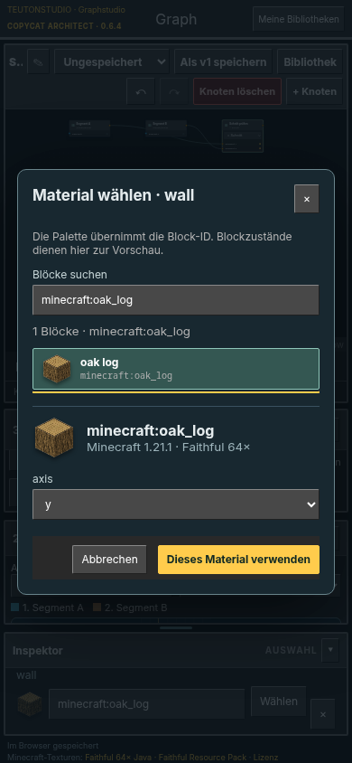

# Graphstudio: Bedienung, direkte Flächen und relative Segmentpositionen

Stand: 20. November 2026. Lokal gebaut und geprüft; keine Veröffentlichung.

## Umsetzung

- Graphkopf: Rückgängig, Wiederholen und Löschen einschließlich Mehrfachauswahl und Verbindungstrennung.
- Gemeinsamer Materialdialog: Blockitem-Miniaturen, Suche, Zustände, Übernehmen/Abbrechen und Tastaturfokus. Paletten übernehmen weiterhin nur die Block-ID; Copycat-Materialgruppen können Zustände speichern.
- Direkte Flächeneingänge an Segmenten und Räumen; Höhe/Tiefe am Verbraucher. Neue Dächer enthalten eigene Dachflächen mit stabilen Anschlüssen, Geschossbindung und Gauben. Die vier bisherigen Umwandler bleiben für gespeicherte Graphen unterstützt und werden bei neuen Knoten ausgeblendet.
- Eigene 2D-Sektion neben 3D und Inspektor: orthografische Ebenen, sichtbarer Ursprung und ganzzahlige unabhängige Eingangsversätze für die vier booleschen Segmentoperatoren. Änderungen erscheinen unmittelbar in 3D; Übernehmen erzeugt einen Undo-Schritt. Unäre Segmentoperationen zeigen Quelle und Ergebnis.
- Optionale neue Felder `operandOffsets` und `roofSections` in Gebäudegraphschema 11; Geometrie und Validierung kommen aus demselben Kotlin-Fachkern für JVM und Browser.

## Abnahme

| Prüfung | Ergebnis |
| --- | --- |
| Kanonischer Kotlin-Fachkern | 55 Tests erfolgreich, keine Fehler oder übersprungenen Fälle |
| Vollständige Copycat-Browser-Testsuite | 33 Testdateien erfolgreich, keine Fehler oder übersprungenen Dateien |
| JVM → Browser → JVM | 28 Fälle mit identischen DTOs und Geometrie; abschließender JVM-Rückimport erfolgreich |
| Organisationsvertrag und Alpha-Modell (`npm test`) | 9 Tests erfolgreich |
| Tatsächlicher Alpha-Produktionsbuild | erfolgreich; erzeugte UI mit Chromium geprüft |
| Browserbedienung | Löschen/Undo/Redo, 2D-Entwurf, leeres Schnittergebnis, Verwerfen/Übernehmen, Materialdialog, Palette, Fokus/Escape, neue Dachflächen und ausgeblendete Umwandler erfolgreich |
| Layout | Desktop 1440×1000, Tablet 820×1180 und Mobil 390×844 |

Der vollständige native Mod-Testlauf wird im vorhandenen Entwicklungsstand
bereits beim Kompilieren der Minecraft-Oberfläche durch unvollständige
`when`-Zweige für die neuen Transformationstypen blockiert
(`BuildingGraphCanvas.kt`, `BuildingInsertionCategories.kt`,
`NodeGraphCanvas.kt`). Der isolierte Lauf baut und prüft den tatsächlichen
Fachkern mit den erforderlichen Projektionen; er verwendet keine nachgebildete
Geometrie. Die hier genannten 55 Tests sind deshalb kein vollständiger
Minecraft-Mod-Build. Der Alpha-Build meldet außerdem bereits vorhandene
Hinweise zu doppelten Beschriftungsschlüsseln und Bundlegrößen.

## Wiederholen

Java 21 und die vorhandenen Gradle-/npm-Abhängigkeiten werden benötigt.
Aus dem Copycat-Fachkern kann der reine Domain-Lauf ausgeführt werden:

```sh
./gradlew -I /pfad/zu/graphstudio/adapters/copycat/web/tools/domain-validation.init.gradle \
  testGraphstudioDomain --offline \
  --tests '*GraphstudioExchangeTest.nativeCorpus' \
  --tests '*DirectAreaInputsTest' --tests '*DynamicAreaSegmentTest' \
  --tests '*SegmentBooleanTest' --tests '*SegmentArrangementTest' \
  --tests '*RoomArrangementTest' --tests '*RoofsTest'
```

Der Lauf erzeugt `build/graphstudio-exchange/native.json`. Im vorbereiteten
Web-Overlay des Fachkerns erzeugt die Browser-Testsuite daraus
`build/graphstudio-exchange/browser.json`:

```sh
cd web
npm run engine
node --test --test-concurrency=1
```

Anschließend im Fachkern:

```sh
./gradlew -I /pfad/zu/graphstudio/adapters/copycat/web/tools/domain-validation.init.gradle \
  testGraphstudioBrowserImport --offline
```

Die lokale Alpha aus dem Graphstudio-Ordner:

```sh
npm test
npm run alpha
npm run preview:alpha
```

Vorschau: `http://127.0.0.1:4319/copycat/`.
Die Browserabnahme benötigt Python mit Playwright und Chromium unter
`/usr/bin/chromium-browser`. Sie verwendet einen separaten Chromium-Kontext mit eigenen
synthetischen Graphen und verändert keine gespeicherten Nutzerprojekte:

```sh
python3 .cache/alpha-copycat/web/tools/verify-authoring-browser.py \
  --url http://127.0.0.1:4319/copycat/ \
  --artifacts /tmp/graphstudio-authoring-browser-check
```

## Ansichten aus dem Produktionsbuild



