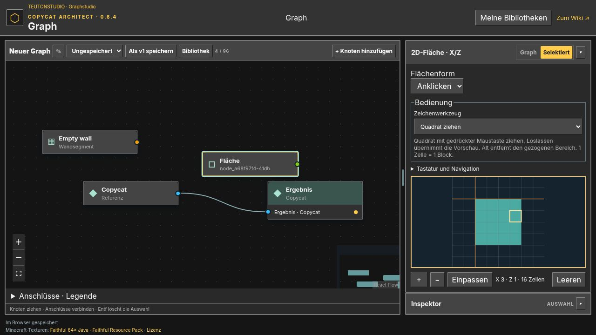
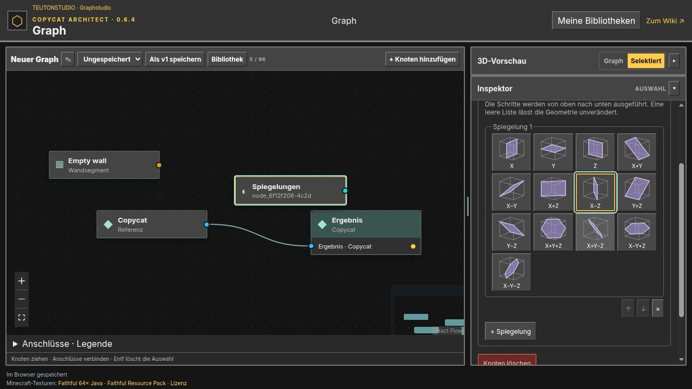

# Mirror grid and area drawing tools · 20 November 2026

The inspector previously squeezed each mirror picker into the flex row beside its
ordering buttons. The picker now spans the row, wraps according to the available
width, labels every plane and keeps a single keyboard focus target. Arrow keys
follow the current grid; Home/End select its first/last plane. Operator-family
mirror settings use the same picker.

Area editing now offers **Malen**, **Rechteck ziehen** and **Quadrat ziehen** under
**Bedienung**. Choosing a tool preserves the current parametric mask in drawing
mode. Dragged shapes preview from the original mask, so shrinking a rectangle
leaves no trail. Release commits one history step, Alt erases and Escape cancels.
The empty-area hint remains stable during a stroke; Ctrl/Cmd+Z reaches graph
history while the raster is focused. Coordinates and the 16384-cell limit retain
the native contract.

The public core remains pinned to `557689c3394747c5474eb492df7da918c687d212`.
These UI changes require no schema or source-pin change.

## Validation

- Public build/channel contract: 3 tests passed.
- Native Gradle suite: 618 tests, no failures or errors.
- Browser suite: 248 tests passed, no skips.
- JVM reimport of all 23 browser exchange cases passed without skips.
- Production Vite build passed.
- Browser checks: 4×2 rectangle = 8 cells, square from the same gesture = 16 cells;
  one undo clears the entire rectangle; painting works; the mirror picker displays
  all 13 planes in several columns and mouse/arrow selection updates the plane.

