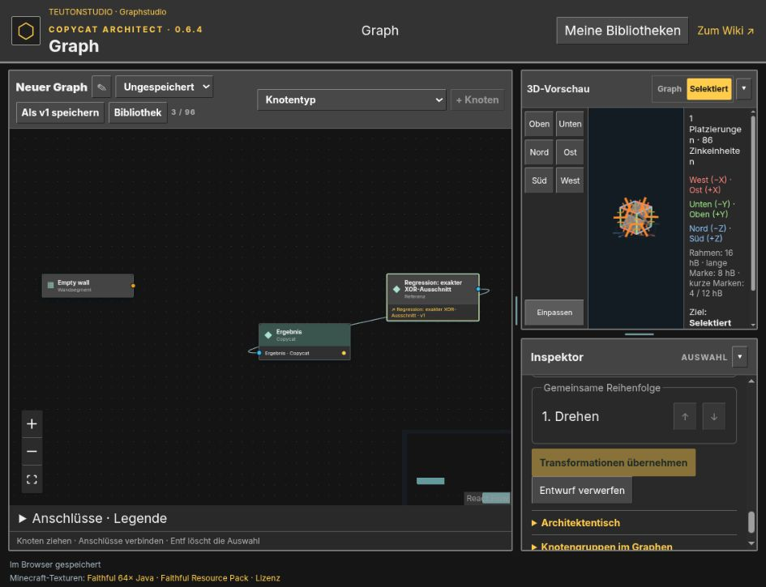

# Graphstudio: Drehung ausgeschnittener Copycat-Referenzen

16.11.2026. Organisationseditor: `adapters/copycat/web`. Fachkern: Arbeitskopie `/home/alex/.codex/worktrees/graphstudio-contract/Copycat Architect`, ausgehend von `629531f65a272476c42ad696405f75ebf06e1e84` mit lokaler Korrektur.

## Ursache und Korrektur

Die Gebäudeauswertung legte gedrehte Referenzen als temporäre Form mit `graph=null` ab. Bei Ausschnitten oder geteilten Materialbereichen schlug die erneute Validierung mit „Clipped parts require their editable node graph“ fehl. Die temporäre Form besitzt jetzt einen begrenzten SAVED-Quellgraphen mit Ergebnisanschluss. Ausschnitte, exakte Flächen und Materialgruppen bleiben erhalten; gespeicherte Vorlagen werden nicht geändert. Die Ablehnung graphloser Ausschnitte an der Dokumentgrenze bleibt bestehen.

Die Korrektur liegt im von Graphstudio kompilierten Kotlin-Fachkern (`BuildingGraph.kt`). Ein JVM-Regressionstest prüft den Referenz-, Operator- und Segmentpfad. `adapters/copycat/web/test/reference-rotation.test.js` prüft den Browserpfad aus Laden einer gespeicherten Form, Bearbeiten des Referenzinspektors, Vorschau, JSON-Rundlauf und nachgeschalteter inverser Drehung im Segment. Raster-Materialbereiche und exakte Dach-XOR-Ausschnitte werden jeweils um X/Y/Z mit 90°, 180° und 270° gedreht.

## Ausgeführte Prüfung

- Derselbe Browserregressionstest scheitert mit dem bisherigen generierten Browserkern in beiden Fällen an der ursprünglichen Fehlermeldung und besteht mit dem neu kompilierten Kern.
- 18 gezielte JVM-Tests bestanden: Transformationsvertrag, Graphstudio-Wertregressionen und Erzeugung des nativen Austauschdatensatzes.
- Alle 205 Browser-Tests bestanden, ohne übersprungene Fälle.
- JVM-Rückimport der Browserexporte bestanden.
- Vite-Produktionsbuild bestanden.
- Echte Browserbedienung: exakte XOR-Form als Referenz ausgewählt, im Referenzinspektor X/90° übernommen, selektierte Vorschau zeigt die Form mit 86 Zinkeinheiten ohne Fehlermeldung.

Der geprüfte Build liegt im lokalen internen Kanal `.internal-dist`. Protokolle liegen in `.cache/reference-rotation-2026-11-16/`. Der öffentliche Quellen-Pin und die veröffentlichte Website wurden nicht verändert. Zur öffentlichen Auslieferung muss zuerst der korrigierte Fachkern veröffentlicht und anschließend der Quellen-Pin aktualisiert werden. Die versehentliche Änderung in der anderen lokalen Mod-Arbeitskopie wurde einschließlich ihrer JAR zurückgenommen.

## Öffentliche Veröffentlichung, 17.11.2026

Die Korrektur ist über [PR #4](https://github.com/TeutonStudio/.github/pull/4) in den öffentlichen Hauptzweig übernommen und [erfolgreich veröffentlicht](https://github.com/TeutonStudio/.github/actions/runs/43999851437). Der öffentliche Quellen-Pin verwendet `a21a9688418a6f0569235cd8df1fa4a56b97bab0`. Der vollständige öffentliche Build besteht einschließlich aller 205 Browser-Tests und 23 Austauschfälle. Live-Manifest, HTML, JavaScript und beide Vorschau-Worker wurden mit dem erfolgreichen Pages-Artifact abgeglichen. Protokolle und Prüfsummen: `.cache/reference-rotation-public-2026-11-17/`.
